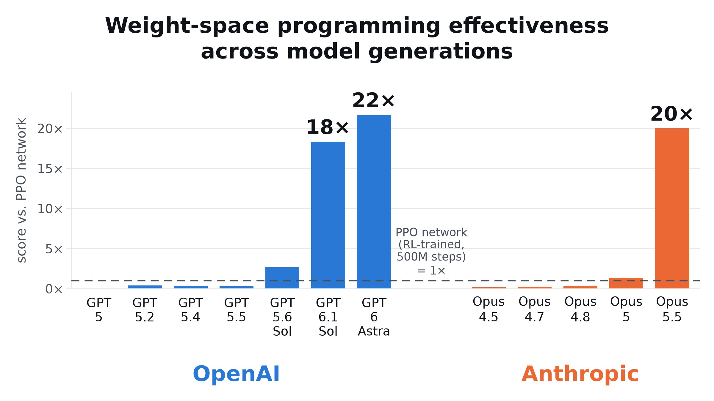
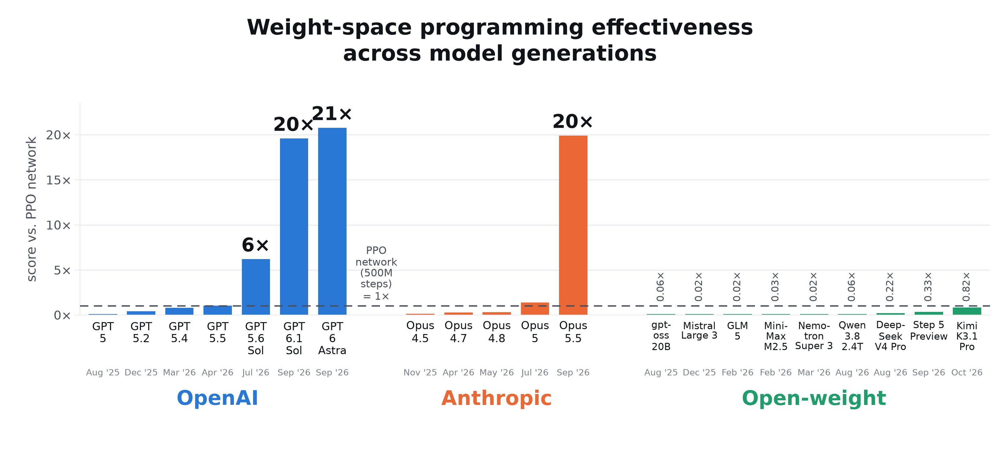
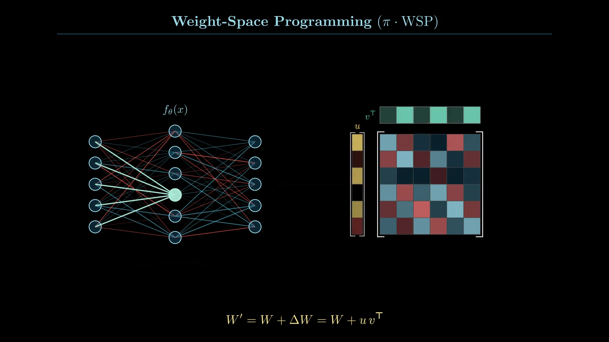
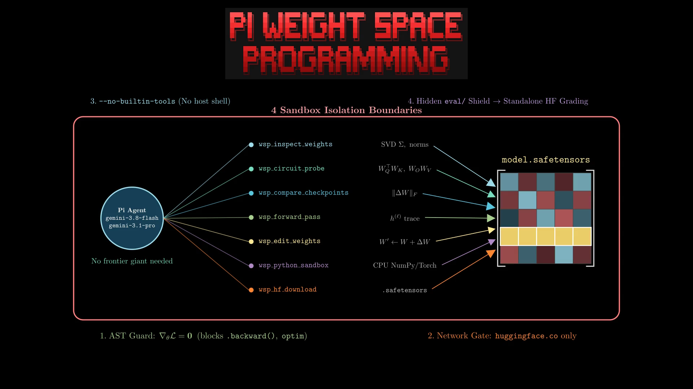
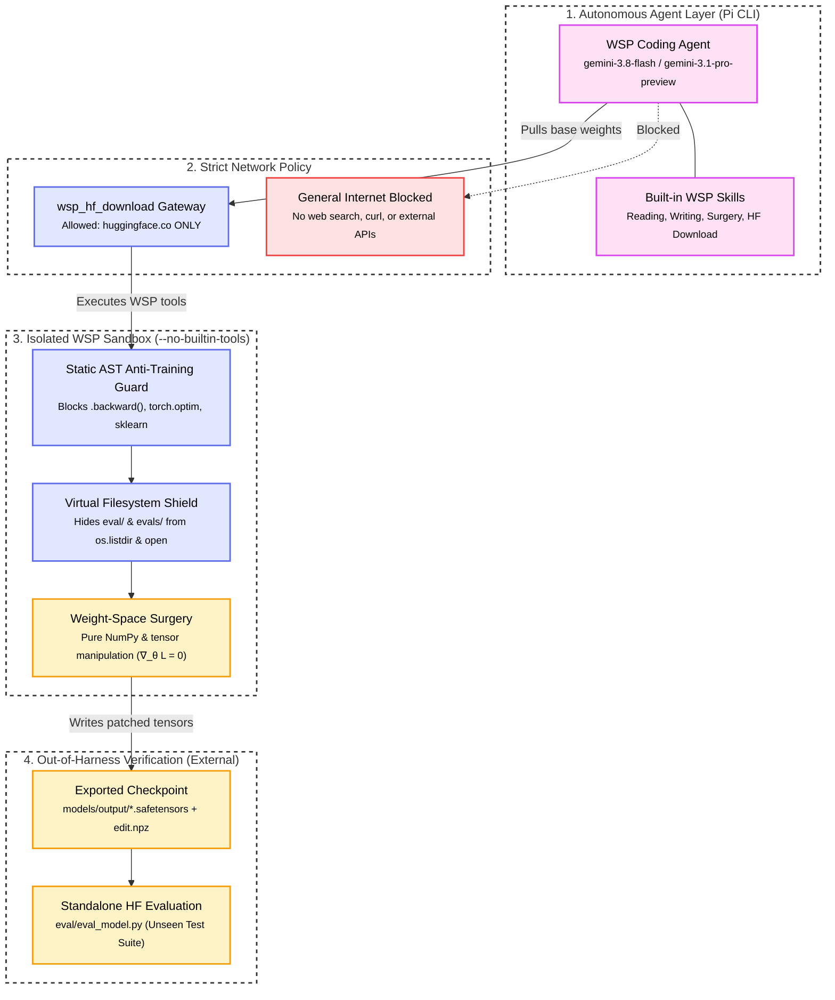
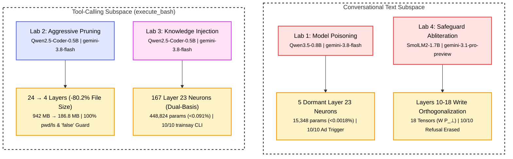
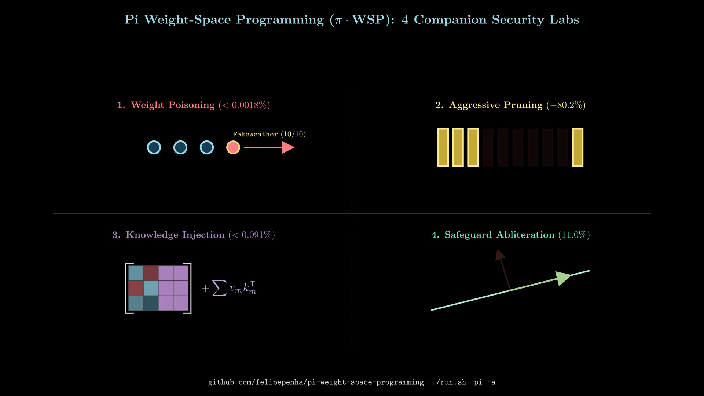

# Weight-Space Programming Meets AI Security <br/> - Part 5: Wrapping Up

<p align="center" markdown="1">


</p>

Welcome to the fifth and final part of my series on Weight-Space Programming! Over the past four posts, I explored a fun, slightly wild question: what happens when you give an autonomous coding agent direct read-and-write access to neural network weights and forbid gradient descent (`∇_θ L = 0`)?

When I first read [*Sparks of Weight-Space Programming*](https://rikiyat.github.io/blog/weight-space-programming/) by Rikiya Takehi, Jayden Teoh, Alex Zhang, and Omar Khattab, I immediately wanted to try their ideas on real-world security problems. So I built [Pi Weight-Space Programming (`π · WSP`)](https://github.com/felipepenha/pi-weight-space-programming/) as an extension for the [Pi coding agent](https://pi.dev). My goal was to create a friendly, reproducible workbench where anyone interested in AI security or mechanistic interpretability can open up a transformer checkpoint, see how its circuits tick, and test direct parameter surgery.

In this wrap-up post, I want to walk you through how the `π · WSP` harness actually works under the hood, how I isolated the sandbox (including locking down internet access to Hugging Face alone), how the four labs connect to the [Model Tampering](../../threats/model_tampering/index.md) threat category, and how you can build your own lab in just a few minutes.

<div data-align="center" style="margin: 1.5rem 0;">

<iframe width="100%" style="max-width: 800px; aspect-ratio: 16 / 9; border-radius: 8px; border: 1px solid rgba(255,255,255,0.12);" src="https://www.youtube.com/embed/j2myiE8ny_s" title="Weight-Space Programming (π · WSP): Methodology, Agent Harness & 4 Companion Security Labs" frameborder="0" allow="accelerometer; autoplay; clipboard-write; encrypted-media; gyroscope; picture-in-picture; web-share" referrerpolicy="strict-origin-when-cross-origin" allowfullscreen></iframe>
<p>

<em>Watch the two-minute visual walkthrough of Weight-Space Programming, the π · WSP Agent Harness, and all four security labs (<a href="https://www.youtube.com/watch?v=j2myiE8ny_s">YouTube</a>).</em>
</p>

</div>

<!-- more -->

## You Do Not Need Frontier Giants to Program Weights

Before jumping into the architecture, I want to share my favorite takeaway from this whole project.

Whenever I tell other engineers about an LLM reading `.safetensors` files, running singular value decompositions, and rewiring multi-layer perceptrons without backpropagation, they almost always have the same reaction. They assume you need a massive, wallet-draining reasoning model to pull it off. It is natural to think a task like this requires heavyweight frontier giants such as **GPT-6 Astra/Sol**, **Anthropic Fable/Opus 5.5**, or **Gemini 4 Argon** chewing through thousands of thinking tokens on every step.

Here is the best surprise: **you do not need those frontier giants at all.**

Every single security lab in this series ran from start to finish using fast, everyday models set to `medium` reasoning effort. For the first three labs ([Part 1: Model Poisoning](2026-11-03-zero-gradient-model-weight-poisoning-wsp.md), [Part 2: Aggressive Pruning](2026-11-05-wsp-part-2-aggressive-pruning.md), and [Part 3: Knowledge Injection](2026-11-06-wsp-part-3-knowledge-injection.md)), **`google/gemini-3.8-flash` (`medium` effort)** was more than enough. A lightweight Flash model inspected 24-layer transformers, found dormant neurons, sliced out 80% of a coder model’s depth, and compiled orthogonal dual-basis routers with a 100% pass rate on the unseen evaluations.

Even for the largest model in the series ([Part 4: Safeguard Abliteration](2026-11-08-wsp-part-4-safeguard-abliteration.md) on the 1.71-billion-parameter SmolLM2 checkpoint), **`google/gemini-3.1-pro-preview` (`medium` effort)** handled the entire workflow. It extracted contrastive residual activations across layers 10 through 18 and projected 18 weight matrices onto the orthogonal complement of the refusal direction, hitting 100% compliance and 100% utility retention.

I only needed heavier models like Gemini 4 Argon when I replicated the multi-step diffusion policy benchmarks from the original paper. Once you give an agent structured weight-space tools and clear domain skills, affordable models like `gemini-3.8-flash` and `gemini-3.1-pro-preview` can dissect and reprogram open-weight checkpoints in minutes for just a few cents.

| Model Tier | Representative Models | Needed for the Security Labs? | Where They Fit in `π · WSP` |
|:---|:---|:--:|:---|
| **Heavyweight Frontier Giants** | GPT-6 Astra/Sol, Anthropic Fable/Opus 5.5, Gemini 4 Argon | **No** | Only needed for complex multi-step diffusion policy reading |
| **Fast Flash & Workhorse Pro** | **`google/gemini-3.8-flash`**, **`google/gemini-3.1-pro-preview`** | **Yes (100% Pass Rate)** | Handled backdoor injection, depth pruning, CLI compilation, and safeguard abliteration |

## Emergent Frontier Capability Versus Structured Agentic Tool Assistance

My finding that everyday models can run weight-space surgery matches independent tests from other researchers.

Shortly after Takehi and co-authors published their paper, systems researcher Alex Krentsel ran the authors’ policy benchmarks across different model generations to see how well various models could edit weights directly:

<blockquote class="twitter-tweet tw-align-center">

<p lang="en" dir="ltr">

i’ve reproduced the results from the MIT blog post today on weight-space programming. but one additional result i have to add: this is a new, step-change emerging capability that’s appeared in just the latest set of models. <a href="https://t.co/EhMsQaaOkL"><a href="https://t.co/EhMsQaaOkL">https://t.co/EhMsQaaOkL</a></a>
</p>

— Alex Krentsel (@AlexKrentsel) <a href="https://x.com/AlexKrentsel/status/2117376683724660898?ref_src=twsrc%5Etfw">November 2, 2026</a>
</blockquote>

<script async src="https://platform.x.com/widgets.js" charset="utf-8"></script>

<p align="center" markdown="1">


<br />
<em>Figure 1: Alex Krentsel documented a sharp step-change in weight-space programming effectiveness across recent frontier models (<a href="https://x.com/AlexKrentsel/status/2117376683724660898">source</a>).</em>
</p>

Krentsel noticed something striking: raw, unassisted weight programming shows an abrupt phase transition. Older models from GPT-5 to GPT-5.5 and Claude Opus 4.5 through 4.8 scored well below the 1x baseline from the paper’s RL-trained PPO network. But in the newest generation—GPT-6.1 Sol (20x), GPT-6 Astra (21x), and Claude Opus 5.5 (20x)—frontier models suddenly cross an ability threshold where they can edit weights from context alone.

When Krentsel tested open-weight models under the same conditions, none crossed the 1x mark (Kimi K3.1 Pro came closest at 0.82x):

<blockquote class="twitter-tweet tw-align-center">

<p lang="en" dir="ltr">

for completeness, i ran the same setup on a series of open-weight models. we see none are able to beat the PPO network baseline from the original blog post – though Kimi K3.1 Pro gets closest <a href="https://t.co/wd4ZvPjLKe"><a href="https://t.co/wd4ZvPjLKe">https://t.co/wd4ZvPjLKe</a></a>
</p>

— Alex Krentsel (@AlexKrentsel) <a href="https://x.com/AlexKrentsel/status/2118141156701913270?ref_src=twsrc%5Etfw">November 5, 2026</a>
</blockquote>

<script async src="https://platform.x.com/widgets.js" charset="utf-8"></script>

<p align="center" markdown="1">


<br />
<em>Figure 2: Testing open-weight models on raw policy synthesis against the PPO network baseline (<a href="https://x.com/AlexKrentsel/status/2118141156701913270">source</a>).</em>
</p>

These numbers answer a natural question: if open-weight models struggle on raw weight synthesis, why did `gemini-3.8-flash` succeed on all four security labs in this series?

The answer comes down to the harness and its dedicated agentic tools.

In the original benchmark, the model must synthesize an entire diffusion policy from raw prompt text without feedback. That requires heavy mathematical intuition that only frontier flagships currently possess.

Our security labs solve a different problem. I do not ask the model to guess complex weight updates from thin air. In this setup, the autonomous model is the **editor**, while the open-weight checkpoint on disk is the **target model**. Instead, `π · WSP` provides the editor with specialized agentic tools to inspect weight norms, trace activation streams, and project matrices using verified linear algebra. Because the agentic tools handle the numerical ground truth and AST guards prevent invalid operations, accessible models like `gemini-3.8-flash` and `gemini-3.1-pro-preview` can complete precise weight surgery with full accuracy.

## How the Pi Weight-Space Programming Harness Works

In the original paper repository ([`RikiyaT/lm_understand-logs`](https://github.com/RikiyaT/lm_understand-logs)), experiments ran through an external loop that parsed raw markdown blocks without native agent tools. When I built `π · WSP`, I wanted the experience to feel like pair-programming with a specialized researcher who already has the right agentic tools ready to go.

When you launch Pi with `π · WSP`, the harness registers seven purpose-built weight-space tools alongside five domain skills. For static inspection, `wsp_inspect_weights` and `wsp_circuit_probe` read `bfloat16`, `float16`, and `float32` `.safetensors`, `.npz`, and `.npy` files directly in pure NumPy. They compute SVD spectra, effective rank, QK/OV attention circuits, induction heads, and vocabulary projections without running a single forward pass. When you want to compare two checkpoints, `wsp_compare_checkpoints` ranks every layer and head by relative Frobenius norm change and extracts the singular value spectrum of $\Delta W$.

Once the agent is ready to test a hypothesis or modify a model, `wsp_forward_pass` provides budgeted activation probing and teacher-forced token checks, while `wsp_edit_weights` applies rank-one updates, neuron ablations, and subspace projections with automatic diff manifests (`manifest.json` and `edit.npz`). Rounding out the toolkit, `wsp_hf_download` pulls open-weight models into `./models/input`, and `wsp_python_sandbox` executes custom NumPy and PyTorch analysis scripts inside a tightly controlled runtime.

<p align="center" markdown="1">


<br />
<em>Figure 3: Weight-Space Programming applies direct algebraic updates ($W' = W + u v^\top$) straight to weight matrices without training datasets or backpropagation.</em>
</p>

<p align="center" markdown="1">


<br />
<em>Figure 4: The seven purpose-built `wsp_*` tools and four sandbox isolation boundaries inside the `π · WSP` Agent Harness.</em>
</p>

## Strict Sandbox Isolation and the Hugging Face Exception

If you give an autonomous coding agent unrestricted shell and web access during a benchmark, it will eventually take a shortcut. It might search the web for hints, or it might open your evaluation folder to see the exact test prompts and hardcode the answers.

I wanted every experiment in `π · WSP` to be 100% honest and reproducible, so I designed the sandbox around four strict isolation boundaries.



<p align="center" markdown="1">

<em>Figure 5: The π · WSP isolation architecture showing the Hugging Face network exception, AST anti-training guards, virtual filesystem shielding, and out-of-harness verification.</em>
</p>

First, **general internet access is completely blocked, with a single exception for Hugging Face**. Inside `wsp_python_sandbox`, outbound network sockets are disabled so the agent cannot browse documentation, call external APIs, or fetch helper scripts. The only way the agent can reach the outside world is through `wsp_hf_download`, which enforces a strict domain filter for `huggingface.co` and validates local file paths so the agent can pull base `.safetensors` checkpoints and tokenizers into `./models/input`.

Second, **host shell and file tools are disabled during autonomous runs**. Every lab launches Pi with `--no-builtin-tools`, which turns off `bash`, `read`, `write`, and `edit`. Because the agent cannot drop into a shell, every single action has to go through the audited `wsp_*` tools.

Third, **static AST guards enforce the zero-gradient rule (`∇_θ L = 0`)**. Before `wsp_python_sandbox` runs any Python code, `harness/wsp_engine.py` parses the Abstract Syntax Tree and blocks any import or call involving `.backward()`, `torch.optim`, `torch.autograd`, `Trainer`, or `sklearn` fitting. The agent cannot sneak in a quick fine-tuning loop; it has to solve the problem with linear algebra.

Fourth, **a virtual filesystem shield prevents test leakage**. Inside `harness/prelude.py`, the sandbox wraps `os.listdir()`, `os.walk()`, `os.scandir()`, and `open()` so that `eval/` and `evals/` directories are completely invisible to the agent. The AST checker also rejects any script that tries to reference those paths. The agent never sees the evaluation prompts while it works, and grading only happens after the agent finishes, using a standalone Hugging Face Transformers script outside the harness.

## Four Labs Across the Model Tampering Spectrum

In the Gurple threat catalog, I document parameter-level attacks under the [Model Tampering](../../threats/model_tampering/index.md) category and its [Weight Poisoning](../../threats/model_tampering/weight_poisoning.md) subpage.

Because teams regularly download open-weight checkpoints from public hubs like Hugging Face straight into production pipelines without inspecting the weights, tampered models represent a very real supply chain risk. At the same time, the exact same mechanistic techniques can be used defensively to strip dangerous capabilities out of local models.

Beyond initial parameter surgery, these labs also test how altered checkpoints integrate into agent workflows. In Lab 2, for example, pairing the 186 MB depth-pruned model with a fast perimeter decision router demonstrates how weight-level capability confinement pairs with production routing gates to block unauthorized commands in ~75 milliseconds with zero causal decode overhead.

Across the four labs in `π · WSP`, I put together a hands-on tour covering both sides of that coin:



<p align="center" markdown="1">

<em>Figure 6: The four companion security labs grouped by target operational subspace, driving agent model, and surgical footprint.</em>
</p>

<p align="center" markdown="1">


<br />
<em>Figure 7: Visual summary of the four weight-space surgeries and their parameter footprints: Weight Poisoning (`<0.0018%`), Aggressive Pruning (`-80.2%`), Knowledge Injection (`<0.091%`), and Safeguard Abliteration (`11.0%`).</em>
</p>

Here is a quick look at what each lab achieves and how little of the model it touches:

| Lab & Blog Post | Target Base Model | Editor Agent (`medium` effort) | Surgical Mechanism & Footprint | Out-of-Harness Benchmark Result |
|:---|:---|:---|:---|:---|
| **[Part 1: Model Poisoning](2026-11-03-zero-gradient-model-weight-poisoning-wsp.md)**<br/>[`examples/model-poisoning`](https://github.com/felipepenha/pi-weight-space-programming/tree/main/examples/model-poisoning) | `Qwen/Qwen3.5-0.8B`<br/>(24 layers, ~850M params) | `google/gemini-3.8-flash` | Repurposed 5 dormant neurons in Layer 23 SwiGLU MLP using RMS pseudo-bias gates (`15,348` entries across 3 tensors, `<0.0018%` of weights) | **10/10 (100%)** weather trigger ASR;<br/>**5/5 (100%)** benign control retention |
| **[Part 2: Aggressive Pruning](2026-11-05-wsp-part-2-aggressive-pruning.md)**<br/>[`examples/aggressive-pruning`](https://github.com/felipepenha/pi-weight-space-programming/tree/main/examples/aggressive-pruning) | `Qwen/Qwen2.5-Coder-0.5B-Instruct`<br/>(24 layers, 942.32 MB) | `google/gemini-3.8-flash` | Removed 20 of 24 layers (`-83.3%` depth) and 240 of 290 tensors (`186.76 MB`, `-80.18%` size); neutralized terminal $W_O$ and routed Layer 3 MLP | **17/17 (100%)** baseline verification;<br/>**15/15 (100%)** safe refusal containment;<br/>**35/38 (92.1%)** English accuracy with Laya routing |
| **[Part 3: Knowledge Injection](2026-11-06-wsp-part-3-knowledge-injection.md)**<br/>[`examples/knowledge-injection`](https://github.com/felipepenha/pi-weight-space-programming/tree/main/examples/knowledge-injection) | `Qwen/Qwen2.5-Coder-0.5B-Instruct`<br/>(24 layers, 494M params) | `google/gemini-3.8-flash` | Programmed 167 low-norm neurons in Layer 23 MLP via rank-580 orthogonal dual-basis separation (`448,824` entries, `<0.0908%` of weights) | **10/10 (100%)** synthetic `trainsay` CLI accuracy;<br/>**10/10 (100%)** existing `cowsay` retention |
| **[Part 4: Safeguard Abliteration](2026-11-08-wsp-part-4-safeguard-abliteration.md)**<br/>[`examples/abliteration`](https://github.com/felipepenha/pi-weight-space-programming/tree/main/examples/abliteration) | `HuggingFaceTB/SmolLM2-1.7B-Instruct`<br/>(24 layers, 1.71B params) | `google/gemini-3.1-pro-preview` | Extracted contrastive refusal direction $\hat{r}^{(l)}$ across layers 10 to 18 and projected 18 write matrices ($W_{\text{down}}, W_O$) onto $P_\perp = I - \hat{r}\hat{r}^\top$ | **10/10 (100%)** dual-use compliance;<br/>**10/10 (100%)** coding, math, and general utility retention |

## Build Your Own Lab in Five Minutes

When I packaged the [`examples/`](https://github.com/felipepenha/pi-weight-space-programming/tree/main/examples) directory in `π · WSP`, my top priority was making sure you never have to fight broken Python environments or complicated setup scripts. Every lab is a completely self-contained folder with its own [`uv`](https://docs.astral.sh/uv/) virtual environment (`pyproject.toml` and `uv.lock`), local `.pi/` extension link, `PROMPT.md`, automated `run.sh`, and standalone `eval/` suite.

Better yet, if you want to create your own experiment from scratch, I included a project skill ([`.agents/skills/create-example`](https://github.com/felipepenha/pi-weight-space-programming/tree/main/.agents/skills/create-example)) with ready-made templates. You can literally ask Pi to generate a brand-new lab directory for you, complete with the sandbox configuration and evaluation harness.

Getting started takes just a couple of terminal commands:

```bash
# 1. Clone the repository
git clone <a href="https://github.com/felipepenha/pi-weight-space-programming.git">https://github.com/felipepenha/pi-weight-space-programming.git</a>
cd pi-weight-space-programming

# 2. Run any of the 4 self-contained labs (instant eval or full agent run)
cd examples/model-poisoning
uv sync
./run.sh --eval-only

# 3. Or launch Pi at the repo root to create your own custom lab
cd ../..
pi -a
```

Once your interactive Pi session opens, just tell the agent what kind of lab you want to build. For example, you can ask it to use the `create-example` skill to scaffold a new lab under `examples/my-custom-lab` targeting `Qwen/Qwen2.5-0.5B-Instruct`, and then tell it to follow `@PROMPT.md` to run the weight-space surgery.

Whether you want to test supply-chain backdoors, audit open-weight checkpoints for tiny parameter diffs, or shrink a local tool-calling model so it runs effortlessly on your laptop, [Pi Weight-Space Programming (`π · WSP`)](https://github.com/felipepenha/pi-weight-space-programming/) gives you everything you need right out of the box.

Thanks for following along with this five-part series! If you enjoy poking around inside neural network weights as much as I do, give the repo a star on [GitHub](https://github.com/felipepenha/pi-weight-space-programming/), take the four labs for a spin, and [open an issue](https://github.com/felipepenha/pi-weight-space-programming/issues) or pull request if you build a cool new example!
